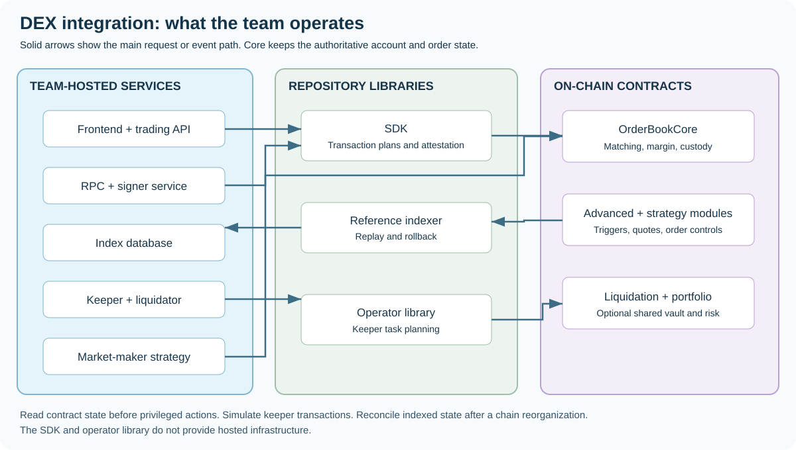
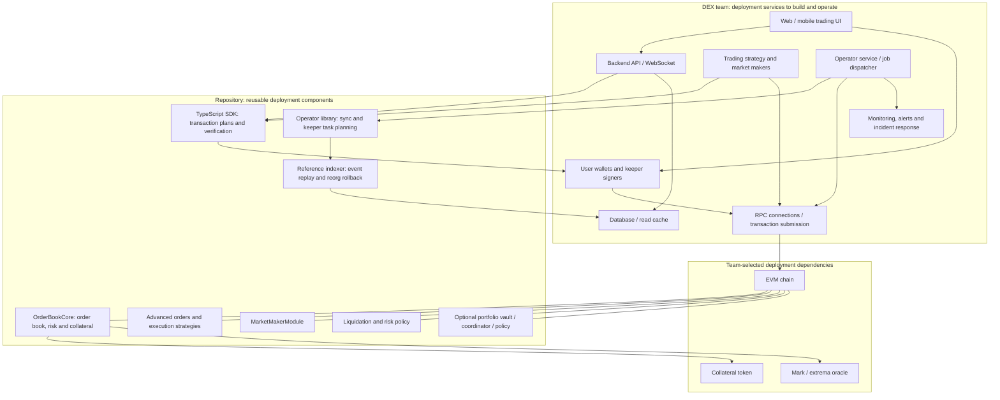
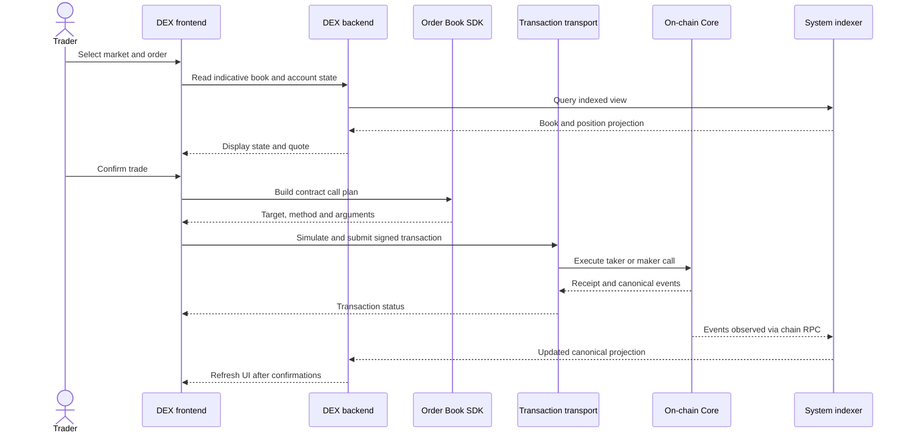
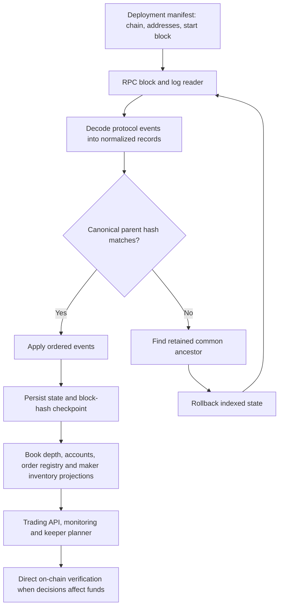
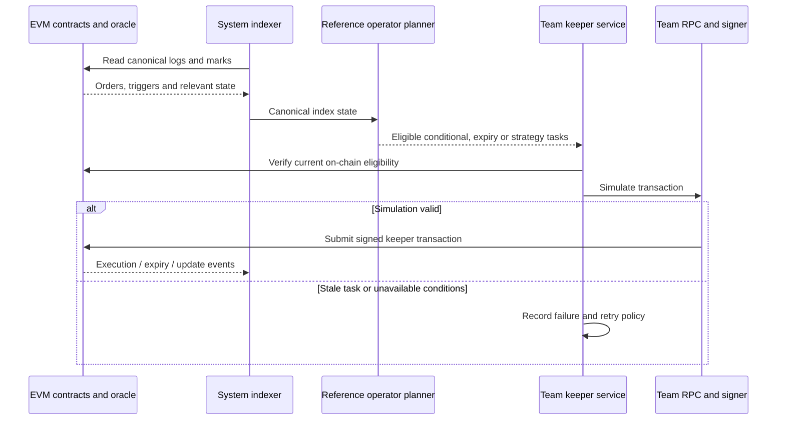
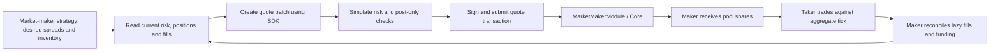
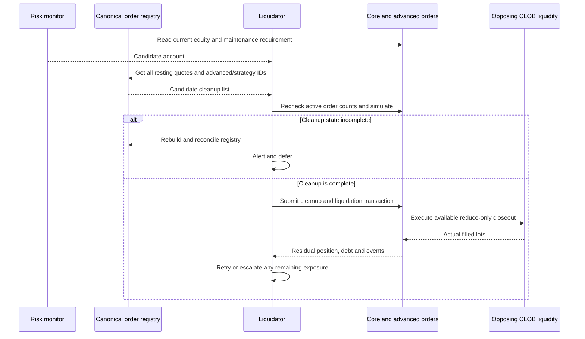
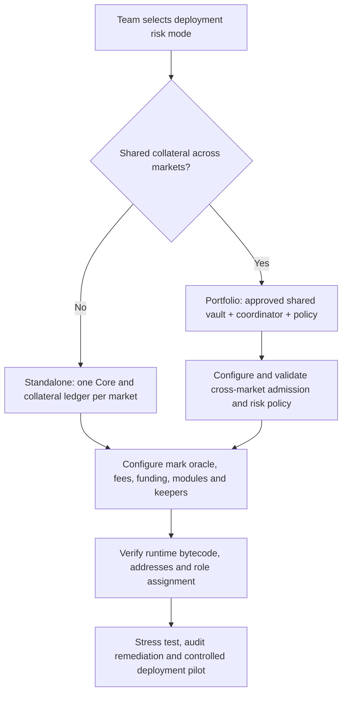
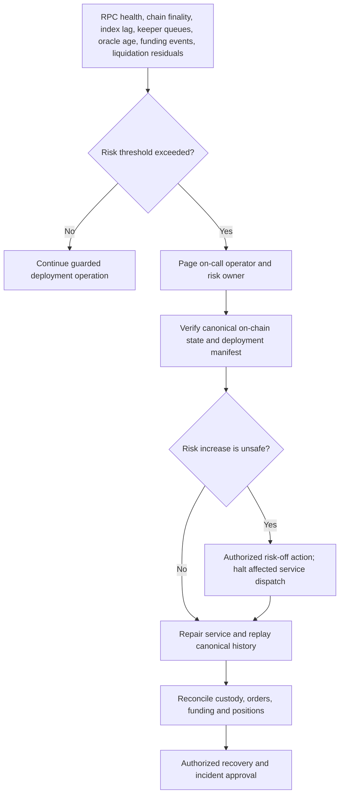

# System Perp DEX Integration: Concepts and Service Flows

This guide shows how a team integrates the deployable contracts with its own perpetual DEX. The on-chain state is authoritative. An indexer makes it easy to read. A keeper submits transactions when a task is due. Neither service owns matching or collateral.

For full procedures, read the [deployment team handbook](TEAM_HANDBOOK.md), [system architecture](SYSTEM_ARCHITECTURE.md), [operator runbook](OPERATOR_RUNBOOK.md), and [deployment guide](SELF_HOSTED_DEPLOYMENT.md).

> **Integration guides:** [List a market](MARKET_LISTING.md) · [Parameter reference](PARAMETER_REFERENCE.md) · [Governance and keys](GOVERNANCE_AND_KEYS.md).

[Edit the architecture diagram](assets/diagrams/source/dex-integration.drawio).

## 1. What a deployment DEX team receives and builds

**System ownership rule:** The repository contains logic and libraries. The team must host the public API, RPC adapters, database, market-making strategy, transaction signers, monitoring and incident response.

## 2. How a deployment trade reaches the chain

**System safety rule:** Never treat the indexer's quote as proof that a trade can execute. Simulate against current contract state before signing when practical. Price movement and transaction ordering can change the result.

## 3. How a deployment indexer reconstructs state

The deployment indexer must handle restarts, duplicate logs, finality delay and bounded reorgs. It must not delete a quote from the liquidation registry based on an unconfirmed event.

## 4. How deployment keepers power advanced orders

**Concept:** A conditional order is stored on-chain, but the EVM does not wake up by itself. A keeper calls the execution function when a condition is satisfied. The contract still checks eligibility. Keepers must remain available for timely execution.

## 5. How deployment makers maintain and settle quotes

At the same tick, makers share fills pro rata. Taker execution changes aggregate tick state; it does not write to every maker account. The maker's deployment inventory model must materialize pending fills before it makes risk decisions.

## 6. How deployment liquidation operators coordinate cleanup

**System warning:** If no opposing liquidity exists, liquidation cannot invent fills. A deployment liquidator must track residual positions, insurance reserves and unfilled closeout attempts.

## 7. Standalone and portfolio deployment deployment choices

Portfolio deployment requires additional review of correlated market moves, funding and shared collateral. A deployment team should qualify standalone operation first.

## 8. How deployment monitoring supports incident response

## 9. System integration checklist

1. Assign owners for contracts, risk, oracle, market makers, indexers, keepers and keys.
2. Select standalone or portfolio deployment mode. Approve the associated margin model.
3. Build a versioned deployment spec and validate the actual bytecode and addresses.
4. Build a frontend and transaction transport around SDK plans.
5. Implement durable canonical event indexing and independent state reconciliation.
6. Implement keeper execution with live reads, transaction simulation and failure recovery.
7. Connect deployment makers with inventory accounting and signed quote workflows.
8. Run liquidation rehearsals with missing orders, missing liquidity and keeper outages.
9. Test funding rotation alerts, oracle faults, reorgs and emergency risk-off behavior.
10. Obtain an external security audit and deployment-specific release approval before unrestricted deployment funds.

The repository supplies no hosted deployment operator and does not guarantee deployment liquidity.
