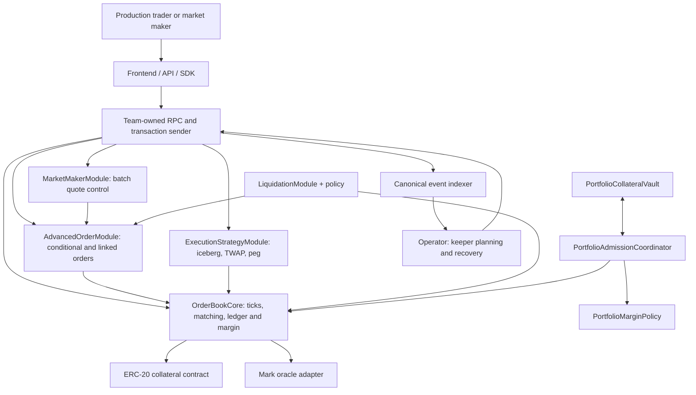
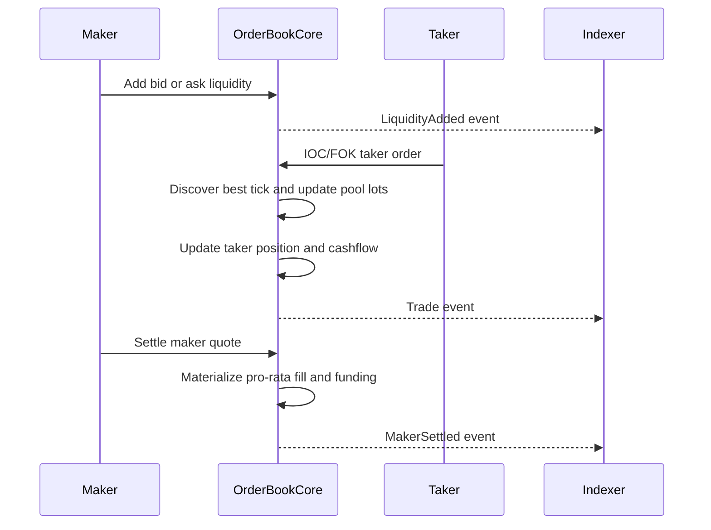
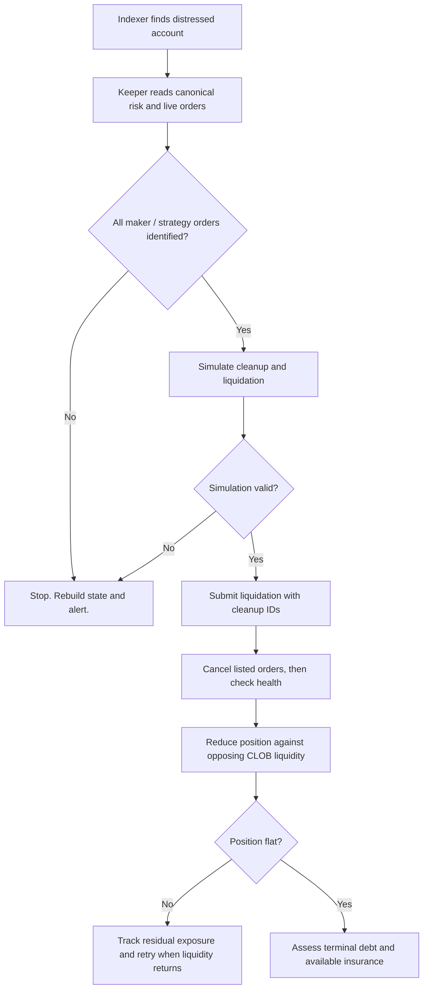
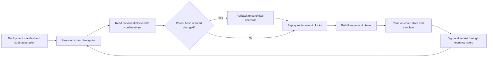

# Production System Architecture and Trust Boundaries

The authoritative production market state resides in EVM contracts. The off-chain systems observe state and submit transactions. They do not replace Core custody or matching.

> **Production integration diagrams:** See [production integration flows](PRODUCTION_INTEGRATION_FLOWS.md) for frontend, SDK, indexer, keeper, market-maker, liquidation, deployment-mode and incident-response diagrams.

## 1. Production component diagram

For standalone production markets, custody is in each `OrderBookCore`. In portfolio production mode, the shared vault holds collateral and the coordinator controls risk admission. These are distinct production deployment modes.

## 2. Production trade and settlement flow

**Production invariant:** Matching does not execute a per-maker write for each taker fill at one tick. Maker inventory must account for fills before materialization.

## 3. Production liquidation flow

A production liquidator cannot close more lots than the order book can execute. Correct risk accounting does not guarantee adequate exit liquidity.

## 4. Production operator recovery flow

Use a transaction store with durable nonces and idempotency. The reference operator library is not a managed production RPC, database or signing service.

## 5. Production security authority matrix

| Actor | Authorized capability | Risk boundary |
| --- | --- | --- |
| Trader | Own deposits, positions and user operations | Cannot withdraw another account's free collateral through ordinary API |
| Maker | Own quotes and settlement | Positions can change through lazy fills before maker settlement |
| Core owner | Configure privileged roles and risk-off controls | Governance compromise can bypass funding wrapper |
| Funding updater | Publish signed index; request one-way risk pause | A wrong index can change trader equity |
| Liquidator / keeper | Trigger eligible cleanup and closeouts | Needs correct order IDs, viable liquidity and gas |
| Oracle operator | Supply market reference and relevant extrema | Stale or manipulated marks can impair margin and execution |
| Portfolio coordinator | Route risk admission and shared collateral changes | Cross-market system has additional correlated risk |
| Indexer | Reconstruct observable state | Reorgs and omissions must not authorize unsafe action |

## 6. Production failure rules

- If the deployment manifest, bytecode identity or wiring does not match, do not start production keepers.
- If oracle freshness or funding calculations are unsafe, stop production risk-increasing activity under the approved response policy.
- If the keeper cannot reconstruct active orders, do not assume the account has no orders. Reconcile and alert.
- If liquidation liquidity is absent, preserve residual exposure in operational metrics. Do not report a completed closeout.
- If a fork or reorg invalidates a checkpoint, replay the canonical branch before publishing keeper actions.
- Do not authorize production operation solely because unit tests and a mainnet fork passed.

See [architecture internals](ARCHITECTURE.md), [production team handbook](PRODUCTION_TEAM_HANDBOOK.md), [operator runbook](OPERATOR_RUNBOOK.md) and [WETH fork review](https://github.com/en0ma/order-book/blob/main/docs/SECURITY_REVIEW_WETH_FORK.md).
